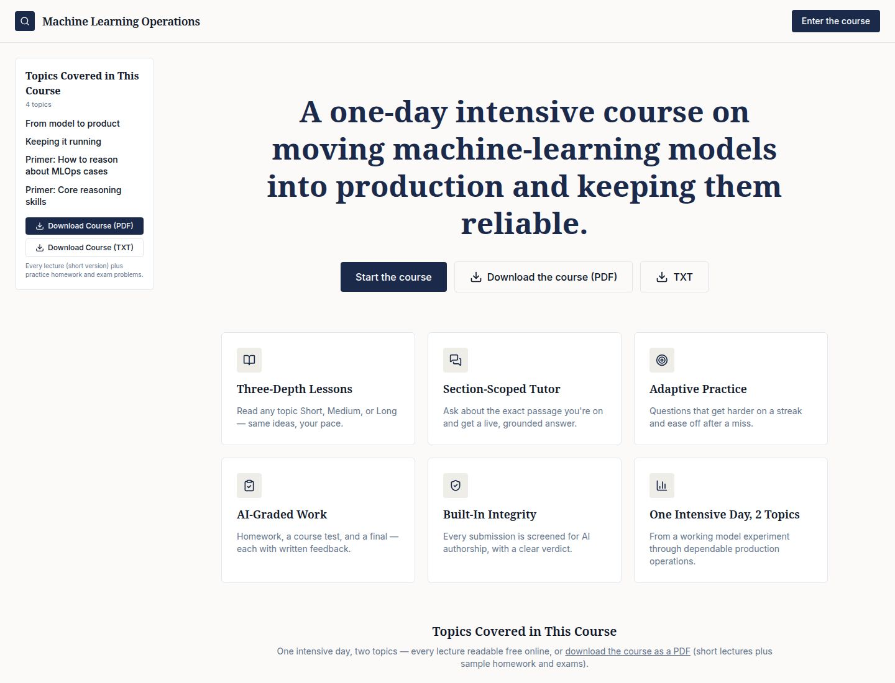

# 🚀 Machine Learning Operations

<div align="center">

### From a promising model experiment to a dependable product.

<strong>A rigorous, self-paced, AI-powered MLOps course for researchers, professionals, and teams who need to ship machine learning responsibly — and keep it working after launch.</strong>

<br />
<br />

[](#-the-learning-journey)
[](#-learn-at-your-pace)
[](#-built-for-real-learning)
[](#-under-the-hood)

</div>

<br />



> **The hard part of ML is not only training a model.**
> It is connecting data, code, features, artifacts, deployment, monitoring, releases, and human decisions into one system you can trust.

---

## ✨ Why this course?

Machine Learning Operations is a **one-day web course taught, tutored, drilled, and graded by AI**. It turns the messy path from notebook to production into a structured learning experience with concrete cases, adaptive practice, grounded tutoring, and built-in academic-integrity screening.

No vague “just deploy it” advice. No definition-only quizzes. Every assessment asks the learner to reason from evidence and make an operational decision.

## 🧭 The learning journey

| Session | What you will work through | The question it answers |
| --- | --- | --- |
| 🟦 **From model to product** | Data pipelines, lineage, linked code/data/model versions, reproducibility, training-serving skew, feature consistency, packaging, batch scoring, real-time serving, and rollback-ready deployment. | **Can this model leave the notebook safely?** |
| 🟪 **Keeping it running** | Prediction monitoring, data drift, concept drift, delayed labels, retraining decisions, shadow and canary releases, A/B tests, latency, cost, incidents, and audit trails. | **How do we know it is still working?** |

### The reasoning primers

Two ungraded primers make the course more than a checklist:

- 🧪 **How to reason about MLOps cases** — diagnose irreproducible experiments, feature skew, delayed ground truth, unsafe retraining, and silent quality decay.
- 🧠 **Core reasoning skills** — practice analysis, inference, evaluation, deduction, and induction in a domain-neutral format.

---

## 🎯 Built for real learning

<table>
<tr>
<td width="50%">

### 📚 Learn at your pace

Every lecture is available in **Short, Medium, or Long** depth while keeping the same examples and learning objectives.

</td>
<td width="50%">

### 💬 Ask a grounded tutor

The section-scoped AI tutor streams answers grounded in the exact lecture passage on screen.

</td>
</tr>
<tr>
<td width="50%">

### 🧩 Practice adaptively

Generated scenario problems adjust difficulty based on recent answers, so practice responds to the learner.

</td>
<td width="50%">

### ✍️ Reason, do not recite

Homework, tests, practice, and diagnostics require multi-step application to realistic production cases.

</td>
</tr>
<tr>
<td width="50%">

### 🏁 See what you know

Two homework sets, a timed course test, and a cumulative final receive semantic grading, per-problem results, and written rationale.

</td>
<td width="50%">

### 🛡️ Protect assessment integrity

Every submission is checked by both a static text detector and diachronic keystroke-pattern analysis.

</td>
</tr>
</table>

## 📦 What is included

- **One intensive day** organized around two core sessions
- **Three lecture depths**: Short, Medium, and Long
- **Section-scoped AI tutoring** with streamed responses
- **Adaptive topic practice** with persistent difficulty
- **Four graded checkpoints**: two homework sets, a course test, and a final
- **Ungraded diagnostic checks** across multiple formats, lengths, and course phases
- **Live analytics** for KPIs, topic mastery, activity, and weak areas
- **Free PDF and TXT course downloads** with no sign-in
- **A built-in product walkthrough video**

## 👥 Designed for

| Audience | Takeaway |
| --- | --- |
| 🔬 **Researchers and professionals entering MLOps** | A foundational but substantial introduction compressed into one focused day. |
| 🛠️ **Product and engineering teams** | A shared language for reproducibility, deployment, monitoring, releases, and incidents. |
| 🎓 **Instructors and curriculum designers** | A working example of AI-taught, AI-graded coursework with integrity controls. |
| 🔎 **Academic-integrity researchers** | A live demonstration of layered authorship screening in an educational product. |

## ⚙️ Under the hood

- **Contract-first API** — OpenAPI is the source of truth; React Query hooks and Zod validators are generated from the same contract.
- **Streaming tutor** — Server-Sent Events deliver section-scoped tutor responses token by token.
- **Adaptive practice engine** — Per-session difficulty persists and changes after correct and incorrect attempts.
- **Two-layer detection** — GPTZero-backed text detection is blended with structural signals, while keystroke analysis evaluates paste-and-rewrite behavior and sustained input patterns.
- **Diagnostic self-tests** — Operator controls verify the database, course seed, model completion, JSON mode, detection pipeline, practice loop, grading loop, and analytics.
- **Auto-reseeded curriculum** — A content marker detects a subject change and replaces stale course material transactionally.

## 🧑‍💻 Run it locally

This is a pnpm workspace with separate artifacts for the course, API server, and walkthrough video.

```bash
pnpm install
pnpm run typecheck
pnpm --filter @workspace/api-server run dev
pnpm --filter @workspace/qr-course run dev
```

The course and API require the environment variables documented in the deployment setup. Secrets are never committed to the repository.

## 🌈 The promise

> **Learn the system, not just the model.**

Machine Learning Operations gives learners a practical mental model for the full lifecycle: **data → features → model → service → signals → decision → release**.

<div align="center">

### Ready to move ML from “it works on my machine” to “we can operate this”?

**Start with the course. Build the habit of asking what the evidence actually proves.**

</div>